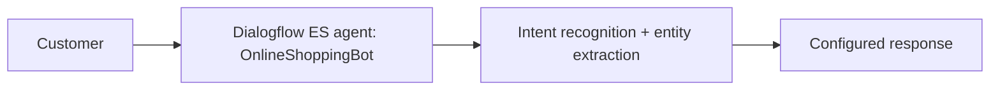

# Online Shopping Chatbot (Google Cloud Dialogflow ES)

A text-based shopping assistant that understands natural-language requests, extracts product type and budget, and responds with configured replies.



## Intents
| Intent | Purpose | Example phrase |
|---|---|---|
| `SearchProduct` | Recognise a shopping request | "I want to buy a laptop" |
| `ProductSearch` | Search by category and ask for budget | "Show me laptops" |
| `AddToCart` | Handle cart requests | "Add the laptop to my cart" |
| `OrderStatus` | Order tracking | "Where is my order?" |

## Entities
- `ProductType`: Laptop, Mobile, Headphones, Camera, Tablet
- `@sys.number`: captures the budget (e.g. 30000, 50000, 70000)

## Sample conversation
> **Customer:** I want to buy a laptop.
> **Bot:** Sure! I can help you find a product. What product are you looking for?
> **Customer:** Show me laptops. -> **Bot:** What is your budget?
> **Customer:** My budget is 50000. -> budget recognised via `@sys.number`
> **Customer:** Add one laptop to my cart. -> cart confirmation
> **Customer:** Where is my order? -> asks for the order ID

## Limitations (basic version)
No live product database, no persistent cart/orders, no payments.

## Planned extension
```
Customer -> Dialogflow ES -> Cloud Functions / Cloud Run -> Firestore (products, cart, orders)
```
Plus authentication, a web chat UI, multilingual and voice support, and Cloud Logging.

## Tech stack
Google Cloud Platform | Dialogflow ES | Intents | Entities | `@sys.number`

## Repository contents
- `images/` - Dialogflow console screenshot
- `report/` - full project report

## Author
**Atharva Vadage** - [GitHub](https://github.com/Atharva72218)
